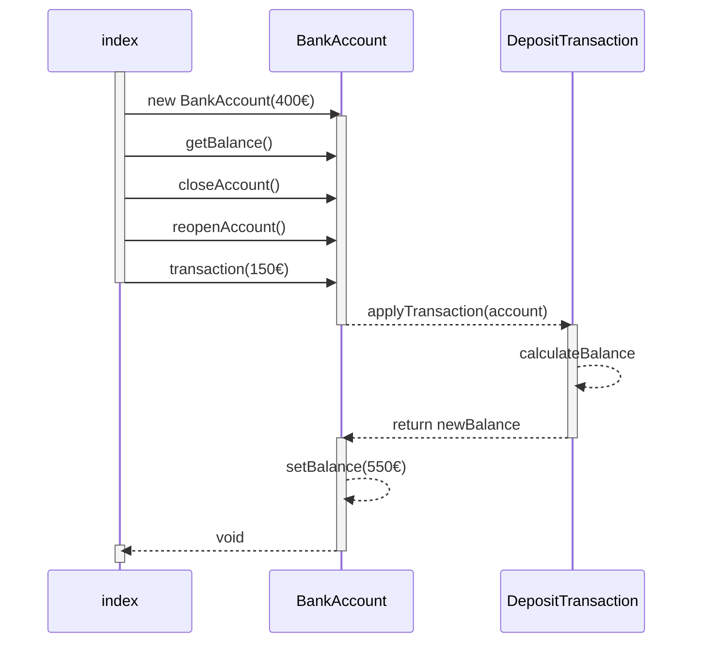

## About ComBank application
> Using this small program to explain about the OOP and PHPUnit.

> To run the program, please read the follow:
#### Requirements
* PHP 8.x

#### Features
1. Open account (with mandatory email validation via `FILTER_VALIDATE_EMAIL`)
2. Apply overdraft (`NoOverdraft`, `SilverOverdraft`, `GoldOverdraft`)
3. Deposit funds
4. Withdraw funds
5. Transfer funds between accounts
6. Apply interest based on overdraft tier (`1%`, `5%`, `10%`)
7. Display balance and transaction history
8. Close and reopen account
9. Manage customers (`Customer`) and bank registry (`Bank`)
10. Specialized accounts (`NationalBankAccount`, `InternationalBankAccount`, `SavingsAccount`)
11. Fraud detection (transaction limit & automatic lock after 3 failed attempts)

#### Installation
```
git clone https://github.com/Stucom-Pelai/MP0613_RA3_POO_Bank.git
```

```
composer install
```

#### Run Unit Test
```
./vendor/bin/phpunit ./tests
```

#### Run Unit Test with report
```
./vendor/bin/phpunit --testdox-html testdox.html
```

#### Manual Test
```
php src/index.php
```

#### Class Diagram
```mermaid
classDiagram
    %% Interfaces y clases abstractas / traits
    <<interface>> BankAccountInterface
    <<interface>> OverdraftInterface
    <<interface>> BankTransactionInterface
    <<abstract>> BaseTransaction
    <<trait>> AmountValidationTrait
    <<trait>> EmailValidationTrait
    <<trait>> FraudDetectionTrait

    %% Implementaciones de interfaces
    BankAccountInterface <|.. BankAccount : implements
    OverdraftInterface <|.. NoOverdraft : implements
    OverdraftInterface <|.. SilverOverdraft : implements
    OverdraftInterface <|.. GoldOverdraft : implements
    BankTransactionInterface <|.. DepositTransaction : implements
    BankTransactionInterface <|.. WithdrawTransaction : implements
    BankTransactionInterface <|.. InterestTransaction : implements
    BankTransactionInterface <|.. TransferTransaction : implements

    %% Herencia
    BankAccount <|-- NationalBankAccount : extends
    BankAccount <|-- InternationalBankAccount : extends
    BankAccount <|-- SavingsAccount : extends
    BaseTransaction <|-- DepositTransaction : extends
    BaseTransaction <|-- WithdrawTransaction : extends
    BaseTransaction <|-- InterestTransaction : extends
    BaseTransaction <|-- TransferTransaction : extends

    %% Uso de traits y asociaciones
    BankAccount --> AmountValidationTrait : use
    BankAccount --> EmailValidationTrait : use
    BankAccount --> FraudDetectionTrait : use
    BaseTransaction --> AmountValidationTrait : use
    Customer --> EmailValidationTrait : use
    BankAccount --> OverdraftInterface : use
    BankAccount --> BankTransactionInterface : use
    BankAccount "0..*" --> "0..1" Customer : owner
    Bank "1" o-- "0..*" BankAccountInterface : manages
    TransferTransaction --> BankAccountInterface : targetAccount

    class BankAccountInterface {
      +STATUS_OPEN
      +STATUS_CLOSED
      +getAccountNumber() string
      +getCurrency() string
      +getBalance() float
      +setBalance(float) void
      +getEmail() string
      +setEmail(string) void
      +getCustomer() Customer
      +setCustomer(Customer) void
      +isOpen() bool
      +closeAccount() void
      +reopenAccount() void
      +transaction(BankTransactionInterface) void
      +transfer(float, BankAccountInterface) void
      +getTransactionHistory() array
      +getOverdraft() OverdraftInterface
      +applyOverdraft(OverdraftInterface) void
      +isBlocked() bool
      +unblockAccount() void
      +setMaxTransactionLimit(float) void
      +getMaxTransactionLimit() float
    }

    class BankAccount {
      #accountNumber
      #currency
      #balance
      #email
      #customer
      #status
      #overdraft
      #transactionHistory
      +getAccountNumber() string
      +getCurrency() string
      +getBalance() float
      +setBalance(float) void
      +getEmail() string
      +setEmail(string) void
      +getCustomer() Customer
      +setCustomer(Customer) void
      +isOpen() bool
      +closeAccount() void
      +reopenAccount() void
      +transaction(BankTransactionInterface) void
      +transfer(float, BankAccountInterface) void
      +getTransactionHistory() array
      +getOverdraft() OverdraftInterface
      +applyOverdraft(OverdraftInterface) void
    }

    class NationalBankAccount {
      +__construct(float, owner)
    }

    class InternationalBankAccount {
      -exchangeRate
      +getExchangeRate() float
      +getConvertedBalance() float
    }

    class SavingsAccount {
      -maxWithdrawals
      -withdrawalCount
      +transaction(BankTransactionInterface) void
      +getMaxWithdrawals() int
      +getWithdrawalCount() int
      +getRemainingWithdrawals() int
    }

    class Customer {
      -name
      -dni
      -email
      -accounts
      +getName() string
      +getDni() string
      +getEmail() string
      +setEmail(string) void
      +addAccount(BankAccountInterface) void
      +hasAccount(BankAccountInterface) bool
      +getAccounts() array
      +getAccountCount() int
      +getTotalBalance() float
    }

    class Bank {
      -name
      -accounts
      +getName() string
      +addAccount(BankAccountInterface) void
      +getAccounts() array
      +getAccountCount() int
      +getAccountByNumber(string) BankAccountInterface
      +getAccountsByEmail(string) array
      +getTotalBalanceByEmail(string) float
      +getAccountsByCustomer(Customer) array
      +getAccountsByDni(string) array
    }

    class OverdraftInterface {
      +isGrantOverdraftFunds(float) bool
      +getOverdraftFundsAmount() float
      +getInterestRate() int
    }

    class NoOverdraft {
      +isGrantOverdraftFunds(float) bool
      +getOverdraftFundsAmount() float
      +getInterestRate() int
    }

    class SilverOverdraft {
      -fundsAmount
      +isGrantOverdraftFunds(float) bool
      +getOverdraftFundsAmount() float
      +getInterestRate() int
    }

    class GoldOverdraft {
      -fundsAmount
      +isGrantOverdraftFunds(float) bool
      +getOverdraftFundsAmount() float
      +getInterestRate() int
    }

    class AmountValidationTrait {
      +validateAmount(float) void
    }

    class EmailValidationTrait {
      +validateEmail(string) void
    }

    class FraudDetectionTrait {
      #maxTransactionLimit
      #failedAttempts
      #maxFailedAttempts
      #blocked
      +setMaxTransactionLimit(float) void
      +getMaxTransactionLimit() float
      +isBlocked() bool
      +getFailedAttempts() int
      +unblockAccount() void
    }

    class BaseTransaction {
      #amount
      +getAmount() float
    }

    class BankTransactionInterface {
      +applyTransaction(BankAccountInterface) float
      +getTransactionInfo() string
      +getAmount() float
    }

    class DepositTransaction {
      +applyTransaction(BankAccountInterface) float
      +getTransactionInfo() string
    }

    class WithdrawTransaction {
      +applyTransaction(BankAccountInterface) float
      +getTransactionInfo() string
    }

    class InterestTransaction {
      +applyTransaction(BankAccountInterface) float
      +getTransactionInfo() string
    }

    class TransferTransaction {
      -targetAccount
      +applyTransaction(BankAccountInterface) float
      +getTargetAccount() BankAccountInterface
      +getTransactionInfo() string
    }
```

#### Sequence Diagram


